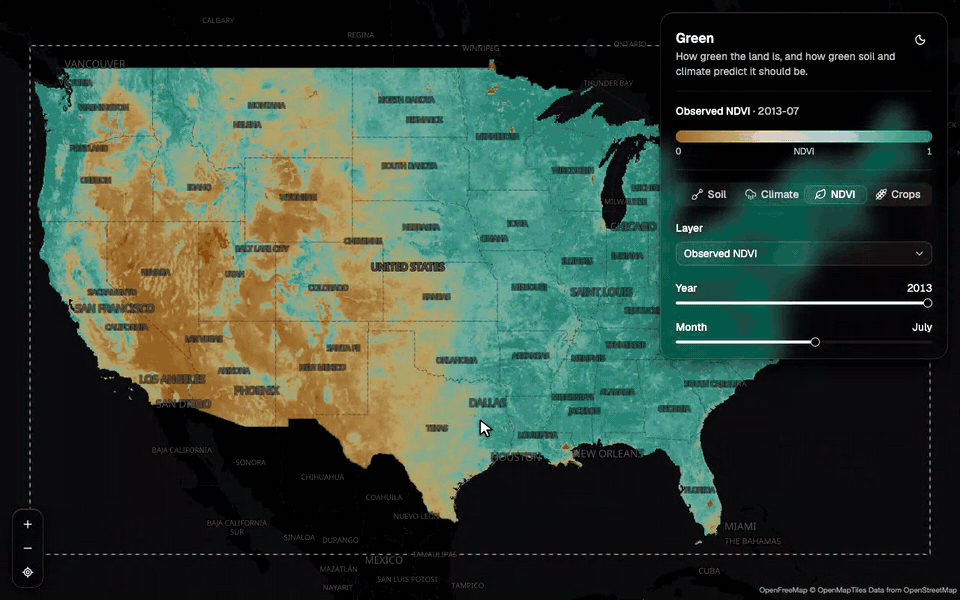

# Green

**How green should this land be, given only its soil and climate?**

[](https://github.com/danmcfan/green/actions/workflows/ci.yml)
[](https://github.com/danmcfan/green/actions/workflows/deploy.yml)
[](LICENSE)

**[Open the map →](https://green.dannyobrien.dev/)**

[](https://green.dannyobrien.dev/)

Green trains a model to predict how green vegetation should be (satellite NDVI) across the continental United States, month by month, using only soil and climate data. It then puts three things side by side on a web map: the inputs, what satellites actually saw, and what the model expected.

The gap between the prediction and what satellites saw is what makes it interesting:

- On **natural land**, the gap shows where soil and climate alone don't explain the vegetation, so the model is missing something.
- On **farm land**, the gap is the **Crop effect**: how much greener or browner farming makes the land than natural vegetation would be under the same soil and weather.

> **Status:** in progress. The map covers the continental US for 2008–2013. The model and its scores are still being improved ([#15](https://github.com/danmcfan/green/issues/15)).

## How it works

```
Earth Engine ──extract──▶ grid arrays ──train──▶ model ──predict──▶ Predicted NDVI ──tiles──▶ PMTiles ──▶ GitHub Release ──▶ map on GitHub Pages
```

- **Grid:** the continental US at 4 km, one value per month ([ADR 0003](docs/adr/0003-conus-4km-monthly-grid.md)).
- **Inputs:** soil from OpenLandMap, plus monthly weather from Daymet (rain, temperature, sunlight, humidity, snow).
- **Observed NDVI:** from the MODIS Terra satellite, and later from VIIRS adjusted to match MODIS ([ADR 0005](docs/adr/0005-modis-then-viirs-observed-ndvi.md), [ADR 0007](docs/adr/0007-modis-while-terra-has-data.md)).
- **Model:** gradient boosting, trained on natural land only (forest, shrub, grass, wetland). It is scored on places and years it never saw, because random cross-validation would overstate how good it is ([research](docs/research/ndvi-target-and-evaluation.md)).
- **Crop effect:** the natural-land model runs on farm land, and the observed value minus the predicted value is the Crop effect. The map also shows how large the model's error is on nearby natural land, so you can tell how far to trust it ([ADR 0006](docs/adr/0006-crop-effect-from-natural-cover-model.md)).
- **Delivery:** every map layer is precomputed as PMTiles, so the site is fully static and needs no server ([ADR 0001](docs/adr/0001-static-site-on-github-pages.md), [ADR 0002](docs/adr/0002-pmtiles-published-from-github-releases.md)).

Terms such as Input layer, Observed NDVI and Crop effect have exact meanings, defined in [GLOSSARY.md](GLOSSARY.md).

## Run it yourself

Install [uv](https://docs.astral.sh/uv/), [bun](https://bun.sh) and [Task](https://taskfile.dev). Then:

```sh
task setup              # install dependencies, create .env
task pipeline:fixture   # run the whole pipeline on synthetic data, no credentials needed
task dev                # map at http://localhost:5173
task check              # lint, test and build: everything CI runs
```

To run on real Earth Engine data, and for logs, limits and deployment, see [docs/running-the-pipeline.md](docs/running-the-pipeline.md).

## Layout

| Path | What |
|---|---|
| `backend/` | Python pipeline (uv, ruff, pytest, scikit-learn, Earth Engine API) |
| `frontend/` | Static map site (Vite, React, shadcn, MapLibre, bun) |
| `layers.json` | One definition of every map layer, shared by backend and frontend ([ADR 0004](docs/adr/0004-single-layer-definition-file.md)) |
| `docs/` | Decision records (`adr/`), research notes and guides |

## Data sources

- [MODIS Terra NDVI (MOD13A1)](https://lpdaac.usgs.gov/products/mod13a1v061/), NASA LP DAAC
- [Daymet](https://daymet.ornl.gov/), ORNL DAAC
- [OpenLandMap](https://openlandmap.org/) soil properties
- [NLCD](https://www.mrlc.gov/) land cover, USGS/MRLC
- [PRISM](https://prism.oregonstate.edu/) grid alignment
- US Census Bureau cartographic boundary files

All are accessed through [Google Earth Engine](https://earthengine.google.com/).

## License

[MIT](LICENSE)
